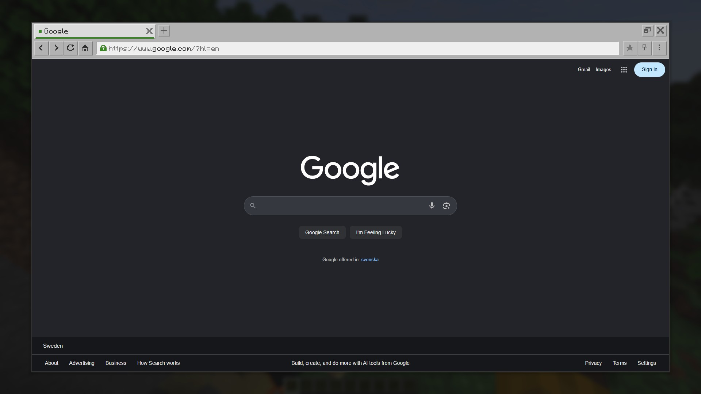
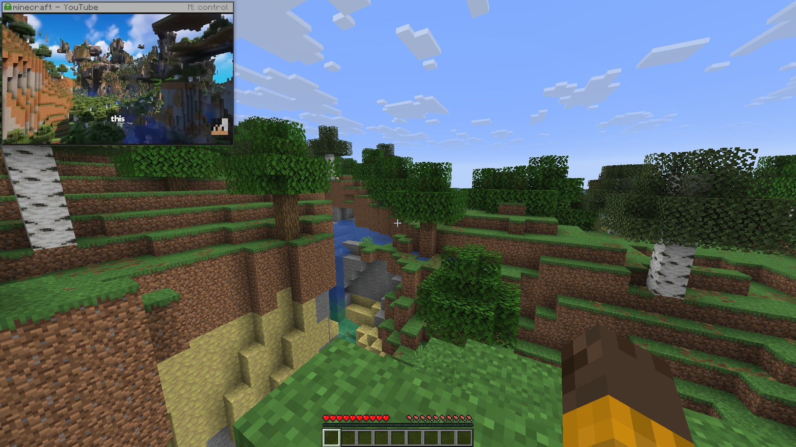

# Pocket Browser

A real browser inside Minecraft. Watch a stream, follow a wiki, keep a guide open, without
alt-tabbing out of the game.

## Read this first

Pocket Browser does not contain a browser. It drives a Chromium-based browser that is already
installed on your computer and shows its picture inside the game. You need one of: Chrome, Edge,
Brave, Vivaldi or Chromium. On Windows, Edge is part of the system, so you almost certainly already
have it.

The mod is client side only. Nothing is needed on the server, and other players do not need it.

The browser runs as a separate hidden program and talks to the mod over a port that listens on
127.0.0.1 only. Nothing is sent anywhere else. The browser loads only the pages you open in it.

## Features

* Full pages
* A pinned mini window
* Video and streams with sound
* Sharp text
* Your accounts work, and the session is kept
* Three looks: Vanilla, Dark and Light

## How to use it

Press B, or click the globe button in the pause menu or on the title screen.

| Key | Action |
|---|---|
| B | Open the browser |
| N | Pin or unpin the mini window |
| M | Take control of the pinned window |
| P | Video: play or pause |
| [ and ] | Rewind or forward 10 seconds |
| O | Mute video |

The pinned window hides while the debug screen (F3) is up, and with the rest of the HUD on F1. All
keys can be changed in Options, Controls.

## Settings

Settings open from the browser's own menu, or from Mod Menu if you have it. Picture holds a quality
preset plus the knobs behind it:

| Preset | Best for |
|---|---|
| Performance | Weaker computers. Smaller picture, lightest on the game. |
| Fluid | Video and fast scrolling. Highest frame rate. |
| Balanced | The default. Full sharpness at a comfortable frame rate. |
| Sharp | Reading. Full size, least compression. |
| Lossless | A perfect picture even while moving, at a low frame rate. |

## Signing in to accounts

Open the browser menu and choose "Sign in to an account". The hidden browser closes and the same
profile opens in an ordinary, visible browser window. Sign in there, then close the window, and the
browser comes back with your session kept.

The mod does not automate that window and never sees what you type into it.

## What it stores

The mod keeps its own browser profile in `.minecraft/pocketbrowser/profile`, sharing nothing with
your everyday browser. That folder holds your signed-in sessions, so do not put it into a modpack,
and exclude it from cloud backups.

Bookmarks and history are kept beside it in plain files holding addresses and titles only.

## Questions

Do I have to install a browser?
Almost certainly not. Windows ships with Edge, and Chrome, Brave, Vivaldi or Chromium work just as
well. If none of them is found, the mod will report it.

Will it slow the game down?
The browser starts when you first open the overlay, stops drawing as soon as nothing is showing it,
and shuts itself down after ten minutes unused.

Do other players need the mod?
No. It is client side only and does not touch the server.

Does the mod send my data anywhere?
No. The mod itself uploads nothing, and the browser loads only the pages you open in it.

## Requirements

* Minecraft 26.1 to 26.2, Fabric Loader 0.16 or newer, Java 25
* [Fabric API](https://modrinth.com/mod/fabric-api), required
* [Mod Menu](https://modrinth.com/mod/modmenu), optional, puts the settings in the mod list
* A Chromium-based browser installed on the computer

## License

[MIT](LICENSE.txt). Free to use, modify and include in modpacks, as long as the copyright notice is
kept.
